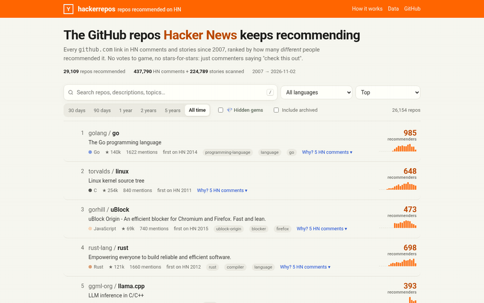

# hackerrepos

**The GitHub repos Hacker News keeps recommending, ranked by how many *different* people linked them.** [HackerTube](https://karpathy.bearblog.dev/hacker-tube/), but for repos.

**Browse it live: [jatingargiitk.github.io/hackerrepos](https://jatingargiitk.github.io/hackerrepos/)**



Every `github.com` link in every HN comment and story since February 2007 (662k items, 622k repo mentions, 271k distinct repos), boiled down to the 29,109 repos that at least three different people pointed at. No votes to game, no stars-for-stars: just commenters saying "check this out", with the comments themselves one click away.

- **Site:** a single static page, [`docs/index.html`](docs/index.html), with search, language and time-window filters, five sorts, a hidden-gems toggle and the HN comments behind every repo.
- **CLI:** `npx hackerrepos` ranks the same data in your terminal.


## Use it

```sh
npx hackerrepos                       # top 25 of all time
npx hackerrepos -w 1y                 # top of the last year (any 30d, 12w, 6m, 5y…)
npx hackerrepos -l rust -s trending   # Rust, recent mentions weighted up
npx hackerrepos -g                    # hidden gems: under 1k stars, 3+ recommenders
npx hackerrepos -q terminal -n 50     # search name, description, topics
npx hackerrepos show junegunn/fzf     # the HN comments that recommended it
npx hackerrepos stats                 # what the dataset covers
npx hackerrepos --json -n 100 | jq .  # machine-readable
```

```
   repo                                 recs  stars lang
 1 golang/go                             985  ★140k Go         The Go programming language
 2 torvalds/linux                        648  ★254k C          Linux kernel source tree
 3 gorhill/uBlock                        473   ★69k JavaScript uBlock Origin - An efficient bloc…
 4 rust-lang/rust                        698  ★121k Rust       Empowering everyone to build reli…
 5 ggml-org/llama.cpp                    393  ★133k C++        LLM inference in C/C++
```

Sorts: `score` (default), `trending`, `recommenders`, `stars`, `recent`. Run `hackerrepos --help` for everything.

To browse the site locally: `npx serve docs` (it fetches `data/` so it needs HTTP, not `file://`).

## How it works

1. **Crawl.** [`src/hn.ts`](src/hn.ts) walks the [HN Algolia API](https://hn.algolia.com/api) (`search_by_date`) for every comment and story containing `github.com`, in date windows that shrink automatically wherever there are more than 1,000 hits. Responses are cached in `.cache/hn`, so a re-run only fetches what's new.
2. **Extract.** [`src/extract.ts`](src/extract.ts) pulls repo links out of story URLs and comment HTML, normalises them (`www.`, `.git`, case, `/tree/…`, `/issues/…`), drops GitHub's own pages (`/features`, `/sponsors`, gists…) and notes what *kind* of link it was.
3. **Enrich.** [`src/github.ts`](src/github.ts) looks every candidate up on GitHub, 50 per GraphQL query, following renames and transfers (so `facebook/react` and `react/react` add up) and dropping deleted repos. Results are cached for a week; when the rate limit runs low it stops cleanly and fills in the rest next run, newest repos first.
4. **Score.** [`src/rank.ts`](src/rank.ts):
   - each person counts **once** per repo, at the weight of their strongest mention: a link to the repo itself counts 1, a file 0.75, an issue, PR or commit 0.25 (those are usually bug reports, not recommendations);
   - recommendation language ("check out", "I use", "highly recommend") adds 25%;
   - self-promotion ("I made", "my project", the owner's own username) counts half and never as a recommender;
   - a story that links the repo counts once for the submitter, plus a bonus for its points;
   - **trending** halves a mention's weight every 90 days;
   - mentions dated before the repo was created are dropped (they were about an older repo with the same name).
5. **List.** A repo makes the list once three different people have recommended it, or it had a 100+ point story. GitHub's policy repos (`github/dmca` and friends) are excluded.

The same `scoreRepo` runs in the CLI and the browser; [`test/site.test.ts`](test/site.test.ts) checks the two stay identical.

## Data

| | |
|---|---|
| HN range | 2007-02-01 → 2026-11-02 |
| Items linking github.com | 437,790 comments + 224,789 stories |
| Repo mentions | 622,098, of 270,965 distinct repos |
| Listed | 29,109 repos |

- [`docs/data/repos.json`](docs/data/repos.json): every listed repo with GitHub metadata and its mentions as `[day, user, weight, flags]` (≈12 MB, ≈4 MB gzipped). This is what the CLI ships with.
- `docs/data/ctx/00.json` … `ff.json`: the HN comment snippets, split into 256 shards by a hash of the repo name, so the site loads only the shard it needs when you open "Why?".

Rebuild it yourself:

```sh
GITHUB_TOKEN=$(gh auth token) npm run data      # full crawl ≈ 10 min, then ≈ 30 s from cache
npm run data -- --from 2024-01-01 --no-github   # quick look, no token
```

[`.github/workflows/refresh.yml`](.github/workflows/refresh.yml) does this every Monday and commits `docs/data` if it changed.

## Develop

```sh
npm ci
npm test        # vitest
npm run lint    # eslint + tsc
npm run build   # dist/ for the npm package
scripts/demo-gif.sh   # re-capture docs/screenshot.png and docs/demo.gif (needs Chrome + ffmpeg)
```

The sources run directly on Node 22.6+ with `node --experimental-strip-types src/cli.ts` (no flag needed from Node 23.6); the published package is plain JS and needs Node 20+.

## Credits

Inspired by Andrej Karpathy's [HackerTube](https://karpathy.bearblog.dev/hacker-tube/), YouTube built from the videos Hacker News recommends. Data from the [HN Algolia API](https://hn.algolia.com/api) and the GitHub API; every quote belongs to its HN author and links back to the original comment.

## License

[MIT](LICENSE) © 2026 Jatin Garg
